# evalx

Eval harness for LLM apps — golden datasets, code + LLM-judge scoring, regression tracking, and CI gates. pytest for AI behavior.

## Quickstart

```bash
pip install -e .
evalx run --suite datasets/demo/v1 --target examples.demo_app:answer
```

The demo target is deliberately naive: it aces easy questions, gets partial
credit on medium ones, and hallucinates on adversarial cases. Watch the harness
catch all of it — mean score 0.500 over 6 cases.

Gate a run in CI:

```bash
evalx run --suite datasets/demo/v1 --target examples.demo_app:answer --fail-under 0.8
# exits 1: mean 0.500 < gate 0.8
```

## How it works

One command runs the whole pipeline — load the exam, ask your app, grade every
answer, remember the run:

```mermaid
flowchart LR
    subgraph S1["📥 PHASE 1 · SETUP"]
        direction TB
        CLI(["⚡ evalx run — you type the command"])
        PARSE["cli.py — flags → arguments; judge built only if asked"]
        LOAD["datasets.py — YAML → TestCases, Pydantic-validated"]
        RESOLVE["adapters.py — module:attr → real function"]
        CLI --> PARSE
        PARSE --> LOAD
        PARSE --> RESOLVE
    end
    subgraph S2["🔁 PHASE 2 · THE LOOP — repeats per case"]
        direction TB
        ASK["Ask the app — answer = answer_fn(question), timed"]
        CODE["Code checks — scorers.py: exact · contains · regex"]
        RUBRIC{"rubric?"}
        LLM["LLM judge — judge.py → LiteLLM, JSON verdict validated"]
        SKIP["judge skipped"]
        BLEND["Blend by weight — _combine_score"]
        CASE["CaseResult — score · latency · reason"]
        ASK --> CODE
        ASK --> RUBRIC
        RUBRIC -->|yes| LLM
        RUBRIC -->|no| SKIP
        CODE --> BLEND
        LLM --> BLEND
        SKIP --> BLEND
        BLEND --> CASE
        CASE -.->|"↺ next case"| ASK
    end
    subgraph S3["📤 PHASE 3 · REPORT + MEMORY"]
        direction TB
        MEAN["RunResult — mean of all case scores"]
        SAVE[("store.py — DuckDB .evalx/runs.duckdb")]
        TABLE["Report — Rich table; gate → exit 0 / 1"]
        CMP["evalx compare — latest-1 vs latest, per-case deltas"]
        MEAN --> SAVE
        MEAN --> TABLE
        SAVE -.-> CMP
    end
    LOAD --> ASK
    RESOLVE --> ASK
    CASE --> MEAN

    classDef input fill:#16283f,stroke:#3b82f6,stroke-width:2px,color:#e6e9f0;
    classDef exec fill:#14301f,stroke:#22c55e,stroke-width:2px,color:#e6e9f0;
    classDef score fill:#2a2145,stroke:#a78bfa,stroke-width:2px,color:#e6e9f0;
    classDef judge fill:#3a2a10,stroke:#f59e0b,stroke-width:2px,color:#e6e9f0;
    classDef out fill:#12303d,stroke:#38bdf8,stroke-width:2px,color:#e6e9f0;
    class CLI,PARSE,LOAD,RESOLVE input;
    class ASK,CASE exec;
    class CODE,BLEND,SKIP score;
    class RUBRIC,LLM judge;
    class MEAN,SAVE,TABLE,CMP out;
```



## What's here (Milestones 1 + 2)

- `evalx/schemas.py` — Pydantic models: `TestCase`, `Check`, `JudgeSpec`,
  `CaseResult`, `RunResult`
- `evalx/datasets.py` — load + validate golden datasets from YAML
- `evalx/scorers.py` — deterministic scorers: `exact_match`, `contains`, `regex`
- `evalx/judge.py` — LLM-as-judge via LiteLLM with built-in bias guards:
  answers scored alone (no position bias), anti-fluff system prompt
  (no verbosity bias), temperature=0, JSON verdicts validated with Pydantic
  (retry once, then raise instead of inventing a score)
- `evalx/adapters.py` — resolve `module:attr` targets to question → answer callables
- `evalx/runner.py` — run every case, combine code checks + judge by weight
- `evalx/cli.py` — `evalx run` with a Rich table, `--fail-under` gate,
  and `--judge-model` (e.g. `anthropic/claude-haiku-5-5`)
- `datasets/demo/v1/cases.yaml` — 6 hand-written golden cases (2 with rubrics)
- `examples/demo_app.py` — deliberately mediocre demo target

## Judge usage

```bash
export ANTHROPIC_API_KEY=...   # or the key for your judge provider
evalx run --suite datasets/demo/v1 --target examples.demo_app:answer \
  --judge-model anthropic/claude-haiku-5-5
```

Only cases with a `judge:` rubric invoke the judge; the rest use code checks.
Two judged cases on Haiku cost a fraction of a cent.

## Run store & comparison (Milestone 3)

Every `evalx run` is saved to `.evalx/runs.duckdb` (override with `EVALX_STORE`):

```bash
evalx run --suite datasets/demo/v1 --target examples.demo_app:answer
# Run saved: 20261019-143022

evalx runs                 # list stored runs, newest first
evalx compare latest-1 latest   # per-case delta table + mean change
```

Run references accept a full id, a unique prefix, `latest`, or `latest-N`.
`--no-save` skips storing a throwaway run.

## Roadmap

- M4: Streamlit dashboard + GitHub Actions gate
