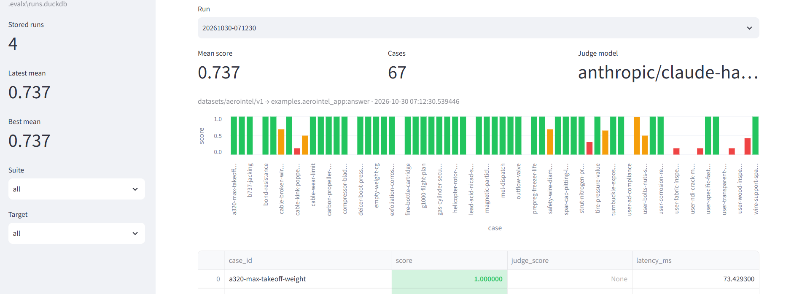
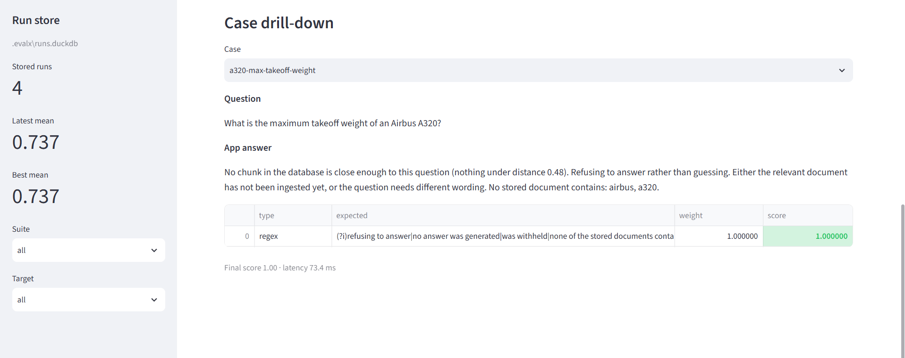

<h1 align="center">evalX</h1>

<p align="center">
  <strong>pytest for AI behavior.</strong> Grade LLM apps with golden datasets,
  code checks + an LLM judge, track every run locally, and gate CI on every
  single case.
</p>

<p align="center">
  <a href="https://github.com/SujahathMSM/evalX/actions/workflows/ci.yml"></a>
  
  
  
</p>

<p align="center">
  <a href="#quickstart">Quickstart</a> ·
  <a href="#features">Features</a> ·
  <a href="#cli-reference">CLI reference</a> ·
  <a href="#dashboard">Dashboard</a> ·
  <a href="#milestones">Milestones</a>
</p>



<p align="center">
  <em>evalX grading a real system: the AeroIntel dogfood run — 67 cases, mean 0.737.</em>
</p>

**Local-first by design.** Every run lives in a single DuckDB file inside your
repo — no account, no cloud, no telemetry. Your eval history sits next to your
code, and the whole loop works offline with a local judge model. promptfoo is
a platform; evalX is the 10-minute, local-first regression catcher for Python
LLM apps.

## Features

- **Golden datasets in YAML** — hand-written cases with weighted code checks
  (`exact_match`, `contains`, `regex`) and optional LLM-judge rubrics.
- **LLM-as-judge with bias guards** — answers scored alone (no position
  bias), an anti-fluff system prompt (no verbosity bias), verdicts validated
  as Pydantic JSON (retry once, then raise — never an invented score).
- **Any text-in → text-out target** — a Python function via `module:attr`, a
  hosted service via a small adapter, or any OpenAI-compatible endpoint
  (Ollama, vLLM, LM Studio, LiteLLM proxies, …) via the generic adapter.
- **Local run store** — every run saved to one DuckDB file in your repo;
  compare any two runs case-by-case.
- **Quality vs cost** — judge tokens and dollar cost are tracked per case
  and per run (priced by LiteLLM, retries included); `evalx compare` shows
  latency and cost changes next to the score deltas.
- **Per-case regression gate** — pin a trusted run as a baseline; CI fails
  if *any single case* drops past your threshold, even when the mean
  improves. A guard refuses baselines from a different dataset.
- **Errors can't hide** — a crashing case is recorded with its error and
  scored 0.0, runs carry error/skipped counts, an infra gate
  (`--max-error-rate`) fails CI on outage fraction *before* the score
  gates, and a run with errors is refused as a baseline.
- **Streamlit dashboard** — run history with trends, per-case drill-down
  (question, answer, per-check scores, judge reasoning), and run compare.
- **CI-ready** — exit-code gates for mean score, per-case regression, and
  error rate; the included GitHub Actions workflow runs lint, tests, and
  an eval gate on every push.

## Proof it works

evalX has graded two real systems (plus its own deterministic demo):

| Target | Suite | Result |
| --- | --- | --- |
| AeroIntel — local aviation-maintenance RAG | 67 cases (35 answerable, 32 must-refuse), judged by Claude Haiku 5.5 | **mean 0.737**; refusals 31/32; one case rescued by the judge (code 0.00 → judge 1.00) |
| Ollama `qwen3:4b-instruct` (local) | 6 general cases via the generic adapter | **mean 0.833**, total cost $0 |
| Demo app (deterministic, deliberately mediocre) | 6 cases | 0.500 by design — the CI gate's calibration fixture |

194 tests (including end-to-end), `ruff` clean, CI green on every push.

## Quickstart

```bash
pip install -e .
evalx run --suite datasets/demo/v1 --target examples.demo_app:answer
```

The demo target is deliberately naive: it aces easy questions, gets partial
credit on medium ones, and hallucinates on adversarial cases. Watch the harness
catch all of it — mean score 0.500 over 6 cases.

Gate a run in CI:

```bash
evalx run --suite datasets/demo/v1 --target examples.demo_app:answer --fail-under 0.8
# exits 1: mean 0.500 < gate 0.8
```

Speed up a big suite by running cases concurrently:

```bash
evalx run --suite datasets/aerointel/v1 --target examples.aerointel_app:answer --workers 8
```

Results keep dataset order and score exactly as a sequential run would. Keep
`--workers` within your target's rate limit (the AeroIntel adapter retries
HTTP 429 with `Retry-After`).

LLM answers vary between identical calls. Measure how much with `--repeats`:

```bash
evalx run --suite datasets/aerointel/v1 --target examples.aerointel_app:answer \
  --repeats 3 --workers 4
```

Each case is asked 3 times; its score is the mean and a **spread** column
(max − min across attempts) shows how noisy it is. Cases that move more than
the regression threshold between identical attempts are listed as noisy, and
a `REGRESSED` line on such a case is marked `(noisy: … may be model noise)` —
the gate still fails, but you can see whether to trust it. The stored answer
and checks are from the lowest-scoring attempt, the one worth debugging.

## How it works

One command runs the whole pipeline — load the exam, ask your app, grade every
answer, remember the run:

```mermaid
flowchart LR
    subgraph S1["📥 PHASE 1 · SETUP"]
        direction TB
        CLI(["⚡ evalx run — you type the command"])
        PARSE["cli.py — flags → arguments; judge built only if asked"]
        LOAD["datasets.py — YAML → TestCases, Pydantic-validated"]
        RESOLVE["adapters.py — module:attr → real function"]
        CLI --> PARSE
        PARSE --> LOAD
        PARSE --> RESOLVE
    end
    subgraph S2["🔁 PHASE 2 · THE LOOP — repeats per case"]
        direction TB
        ASK["Ask the app — answer = answer_fn(question), timed"]
        CODE["Code checks — scorers.py: exact · contains · regex"]
        RUBRIC{"rubric?"}
        LLM["LLM judge — judge.py → LiteLLM, JSON verdict validated"]
        SKIP["judge skipped"]
        BLEND["Blend by weight — _combine_score"]
        CASE["CaseResult — score · latency · reason"]
        ASK --> CODE
        ASK --> RUBRIC
        RUBRIC -->|yes| LLM
        RUBRIC -->|no| SKIP
        CODE --> BLEND
        LLM --> BLEND
        SKIP --> BLEND
        BLEND --> CASE
        CASE -.->|"↺ next case"| ASK
    end
    subgraph S3["📤 PHASE 3 · REPORT + MEMORY"]
        direction TB
        MEAN["RunResult — mean of all case scores"]
        SAVE[("store.py — DuckDB .evalx/runs.duckdb")]
        TABLE["Report — Rich table; gate → exit 0 / 1"]
        CMP["evalx compare — latest-1 vs latest, per-case deltas"]
        MEAN --> SAVE
        MEAN --> TABLE
        SAVE -.-> CMP
    end
    LOAD --> ASK
    RESOLVE --> ASK
    CASE --> MEAN

    classDef input fill:#16283f,stroke:#3b82f6,stroke-width:2px,color:#e6e9f0;
    classDef exec fill:#14301f,stroke:#22c55e,stroke-width:2px,color:#e6e9f0;
    classDef score fill:#2a2145,stroke:#a78bfa,stroke-width:2px,color:#e6e9f0;
    classDef judge fill:#3a2a10,stroke:#f59e0b,stroke-width:2px,color:#e6e9f0;
    classDef out fill:#12303d,stroke:#38bdf8,stroke-width:2px,color:#e6e9f0;
    class CLI,PARSE,LOAD,RESOLVE input;
    class ASK,CASE exec;
    class CODE,BLEND,SKIP score;
    class RUBRIC,LLM judge;
    class MEAN,SAVE,TABLE,CMP out;
```



## CLI reference

| Command | What it does | Key options |
| --- | --- | --- |
| `evalx run` | Run a suite against a target, print the per-case table, save the run | `--suite`, `--target`, `--judge-model`, `--judge-temperature`, `--fail-under`, `--baseline`, `--fail-on-regression` (default 0.2), `--max-error-rate` (default 0.0), `--workers` (default 1), `--repeats` (default 1), `--no-save` |
| `evalx runs` | List stored runs, newest first, with mean, error/skipped counts, judge cost, wall time and workers | — |
| `evalx compare A B` | Per-case score, latency and judge-cost deltas plus whole-run wall time between two runs (refs: full id, unique prefix, `latest`, `latest-N`) | — |
| `evalx baseline pin REF` | Pin a stored run as a named baseline (`--name`, default `stable`) | `--allow-errors` (required if the run contains error cases) |
| `evalx baseline list` | List pinned baselines | — |
| `evalx dashboard` | Launch the Streamlit dashboard | `--port` (default 8501) |
| `evalx version` | Print the version | — |

## What's here

- `evalx/schemas.py` — Pydantic models: `TestCase`, `Check`, `JudgeSpec`,
  `CaseResult`, `RunResult`
- `evalx/datasets.py` — load + validate golden datasets from YAML
- `evalx/scorers.py` — deterministic scorers: `exact_match`, `contains`, `regex`
- `evalx/judge.py` — LLM-as-judge via LiteLLM with built-in bias guards:
  answers scored alone (no position bias), anti-fluff system prompt
  (no verbosity bias), JSON verdicts validated with Pydantic (retry once,
  then raise instead of inventing a score), temperature optional — some
  models (e.g. claude-haiku-5-5) reject a forced temperature, so the
  parameter is omitted unless you set it
- `evalx/adapters.py` — resolve `module:attr` targets to question → answer callables
- `evalx/runner.py` — run every case, combine code checks + judge by weight;
  a failing case is recorded with its error, never aborts the run
- `evalx/store.py` — DuckDB run store: save runs, list them, resolve
  `latest` / `latest-N` / id-prefix references, compare two runs per case,
  pin and check baselines
- `evalx/cli.py` — the Typer CLI above (Rich tables, exit-code gates)
- `evalx/dashboard.py` — Streamlit dashboard: run history, per-run detail,
  run-over-run compare
- `.github/workflows/ci.yml` — CI on every push: lint, tests, and the demo
  suite gated at `--fail-under 0.4`
- `datasets/demo/v1/cases.yaml` — 6 hand-written golden cases (2 with rubrics)
- `datasets/aerointel/v1/cases.yaml` — 67 cases converted from AeroIntel's
  golden set
- `datasets/general/v1/cases.yaml` — 6 general-knowledge cases for bare LLMs
- `examples/demo_app.py` — deliberately mediocre demo target
- `examples/aerointel_app.py` — HTTP adapter for AeroIntel (token auth,
  429 retry with `Retry-After`)
- `examples/openai_compatible_app.py` — generic adapter for any
  OpenAI-compatible endpoint (Ollama by default)

## Judge usage

```bash
export ANTHROPIC_API_KEY=...   # or the key for your judge provider
evalx run --suite datasets/demo/v1 --target examples.demo_app:answer \
  --judge-model anthropic/claude-haiku-5-5
```

Only cases with a `judge:` rubric invoke the judge; the rest use code checks.
Two judged cases on Haiku cost a fraction of a cent. Cases with a rubric and no checks are skipped when you run without
`--judge-model` (listed in the output, left out of the mean) rather than
scored 0.

A case never aborts the run: if your target or the judge raises, that case
records the error (shown in the CLI and the dashboard drill-down) and scores
0.0, so a crashing app can't slip past the gate.

## Run store & comparison

Every `evalx run` is saved to `.evalx/runs.duckdb` (override with `EVALX_STORE`):

```bash
evalx run --suite datasets/demo/v1 --target examples.demo_app:answer
# Run saved: 20261019-143022

evalx runs                 # list stored runs, newest first
evalx compare latest-1 latest   # per-case delta table + mean change
```

Run references accept a full id, a unique prefix, `latest`, or `latest-N`.
`--no-save` skips storing a throwaway run. The runs list shows each run's
error and skipped counts (`–` for runs stored before those were tracked).

Judged runs also record what the judge consumed: tokens and cost per case
(retries included), totalled per run. `evalx run` prints the total, and
`evalx compare` adds per-case latency and judge cost plus a summary, for
example:

```
Mean: 0.500 -> 0.750 (+0.250) | 2 improved, 0 regressed, 4 unchanged
Latency (mean per case): 1200 -> 800 ms (-33%)
Judge cost: $0.0020 -> $0.0016 (-20%)
Wall time (whole run): 7.4s -> 5.1s (-31%) | workers 1 -> 1
```

Every run also records its wall-clock time and `--workers`. Compare prints
them on a `Wall time (whole run)` line and notes when the two runs used
different worker counts: per-case latency includes queueing at the target,
so a parallel run can show higher latency per case and still finish sooner.

Cost comes from LiteLLM's price table. For a model it has no price for (a
local or custom endpoint), tokens are still recorded and cost shows as `–`,
never as a misleading $0.

## Baselines & the regression gate (M5)

A mean-score gate can pass while one case craters. Pin a run you trust as a
baseline, and every later run is also graded case-by-case against it:

```bash
evalx baseline pin 20261030-071230 --name aerointel   # bookmark a stored run
evalx baseline list                                   # see your bookmarks

evalx run --suite datasets/aerointel/v1 --target examples.aerointel_app:answer \
  --baseline aerointel                                # fail if any case drops > 0.2
```

A case fails the gate only when its score drops by *more* than the threshold
(`--fail-on-regression`, default 0.2 — a drop of exactly 0.2 still passes).
Cases added or removed since the baseline are reported as warnings, never
failures: a changed dataset is not a regression.

A baseline is only meaningful against the **same dataset** — the comparison
matches on case ids. If a run and its baseline share no cases at all, the
gate refuses with an error instead of passing a comparison that never
happened; if the baseline came from a differently-named suite, the shared
cases are still compared, with a warning. Baselines live in the local run
store, so a CI gate needs a store that contains the pin.

A run with error cases (the target or judge raised) is refused as a
baseline unless you pass `--allow-errors`: a baseline built on an outage
would hide every later regression. To keep an outage from passing as a
quality drop in the first place, `evalx run --max-error-rate` (default 0.0)
adds an infra gate that fails the run on its fraction of errored cases,
reported before the score gates.

## Dashboard

```bash
evalx dashboard            # http://localhost:8501  (add --port N if busy)
```

Three tabs over your stored runs: **Runs** (history table with error counts
and a mean-score trend line), **Run detail** (per-case scores for one run),
and **Compare** (pick a baseline and a challenger — per-case deltas with
▲/▼ markers). Needs the dev extras: `pip install -e ".[dev]"`.



*Case drill-down — the stored question, the app's actual answer (here a
refusal, returned verbatim by the adapter), and the per-check scores behind
the final grade. The run-detail view of the same run is the screenshot at
the top of this README.*

## Configuration

| Variable | Used by | Purpose |
| --- | --- | --- |
| `EVALX_STORE` | run store | Path of the DuckDB run-store file (default `.evalx/runs.duckdb`) |
| `ANTHROPIC_API_KEY` (or your provider's key) | LLM judge | API key for the `--judge-model` provider, via LiteLLM |
| `AEROINTEL_URL` | AeroIntel adapter | Base URL (default `http://127.0.0.1:8000`) |
| `AEROINTEL_CLIENT_ID` / `AEROINTEL_CLIENT_SECRET` | AeroIntel adapter | Token-auth credentials for AeroIntel's `/auth/token` |
| `OPENAI_COMPAT_BASE_URL` | generic adapter | Endpoint base URL (default `http://localhost:11434/v1` — Ollama) |
| `OPENAI_COMPAT_MODEL` | generic adapter | Model name — **required**, no default |
| `OPENAI_COMPAT_API_KEY` | generic adapter | Optional bearer key for hosted endpoints |
| `OPENAI_COMPAT_SYSTEM_PROMPT` | generic adapter | Optional system prompt (handy for prompt A/B runs) |
| `OPENAI_COMPAT_TEMPERATURE` | generic adapter | Optional temperature; omitted unless set |

## Development

```bash
pip install -e ".[dev,e2e]"           # pytest, ruff, streamlit, pandas, playwright
python -m playwright install chromium # browser for the dashboard E2E test
python -m pytest                      # 194 tests
ruff check .
```

`tests/e2e/` tests evalX end to end the way a user runs it: a real `evalx`
process grades the OpenAI-compatible adapter against a local fake LLM server
(real HTTP, real LiteLLM judge calls, real DuckDB store, real exit codes),
and the dashboard is rendered in headless Chromium. No API key needed; the
dashboard test skips if Playwright isn't installed. One opt-in check hits a
real judge model: `ANTHROPIC_API_KEY=... python -m pytest -m live`.

CI (`.github/workflows/ci.yml`) runs the same lint + tests on every push and
pull request, then gates the deterministic demo suite at
`--fail-under 0.4` (its designed mean is 0.500, so the gate verifies the
grading itself).

## Milestones

- **M1 — core harness:** YAML golden datasets, code scorers
  (exact / contains / regex), runner, CLI with a mean-score gate.
- **M2 — LLM-as-judge:** rubric scoring through LiteLLM with bias guards —
  Pydantic-validated JSON verdicts, retry once, never an invented score.
- **M3 — run store & compare:** every run saved to a local DuckDB file;
  per-case deltas between any two runs.
- **M4 — dashboard + CI:** Streamlit dashboard over the stored runs
  (history, case drill-down, compare); GitHub Actions runs lint, tests,
  and the eval gate on every push.
- **M5 — baselines & regression gate:** pin a run and fail when *any
  single case* drops past a threshold, even if the mean improved — with a
  guard against baselines from a different dataset. See "Baselines & the
  regression gate" above.
- **Dogfooding:** evalX graded AeroIntel, a local aviation-maintenance
  RAG, on a 67-case dataset built from its own golden set (35 answerable +
  32 must-refuse): mean **0.737** with an LLM judge, with 31 of 32
  must-refuse questions refused correctly. Dataset in
  `datasets/aerointel/v1`, adapter in `examples/aerointel_app.py`,
  screenshots in the Dashboard section above.

- **Concurrent runs:** `evalx run --workers N` grades N cases at once on a
  thread pool, with results in dataset order — identical to a sequential
  run.
- **Quality vs cost:** judge tokens and cost per case and per run, with
  latency and cost deltas next to score deltas in `evalx compare` and the
  dashboard.

- **Repeat runs:** `--repeats N` scores every case N times — mean score,
  per-case spread, noisy cases flagged in the run and on regressions.

## Roadmap

- **More scorers:** `not_contains`, JSON-schema validity, numeric
  tolerance, max length.

## License

MIT — see [LICENSE](LICENSE).
